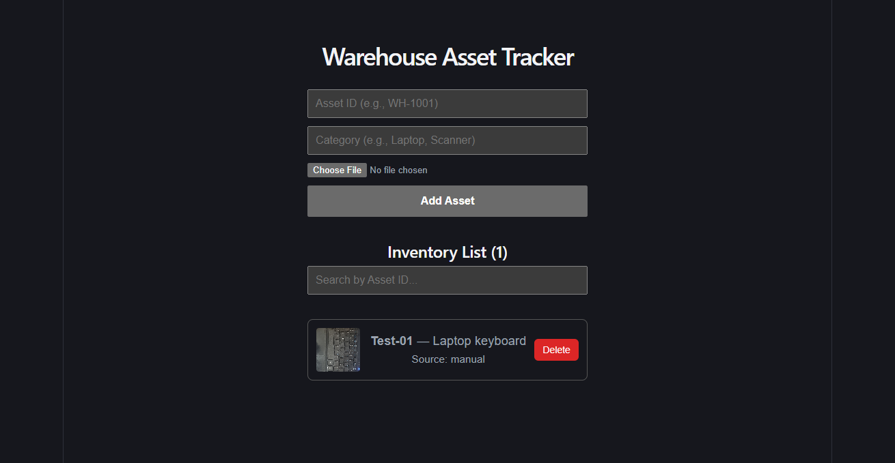
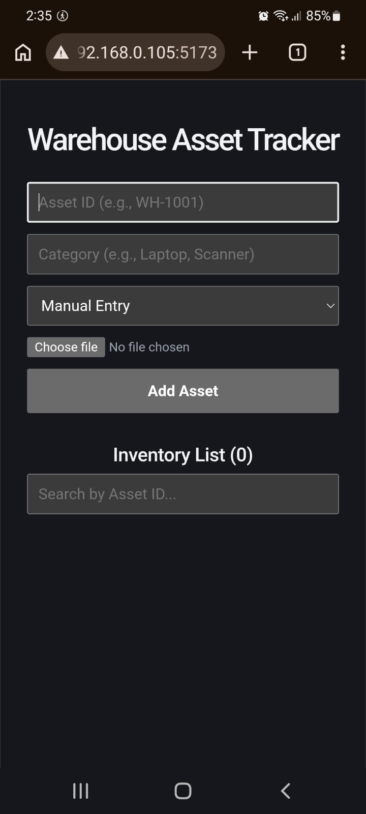
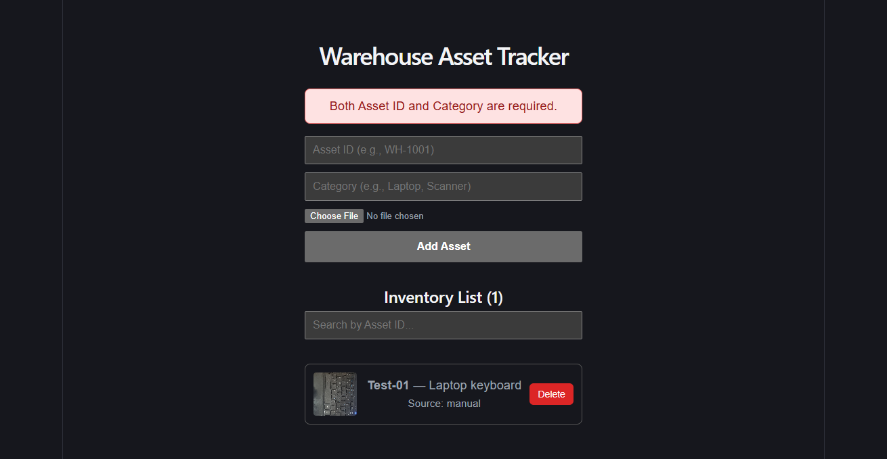
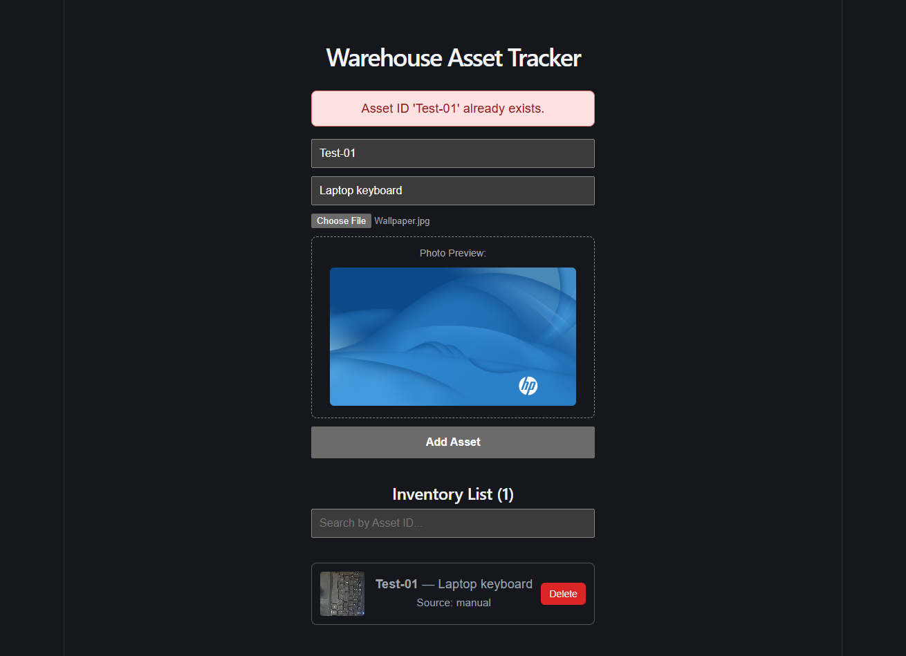
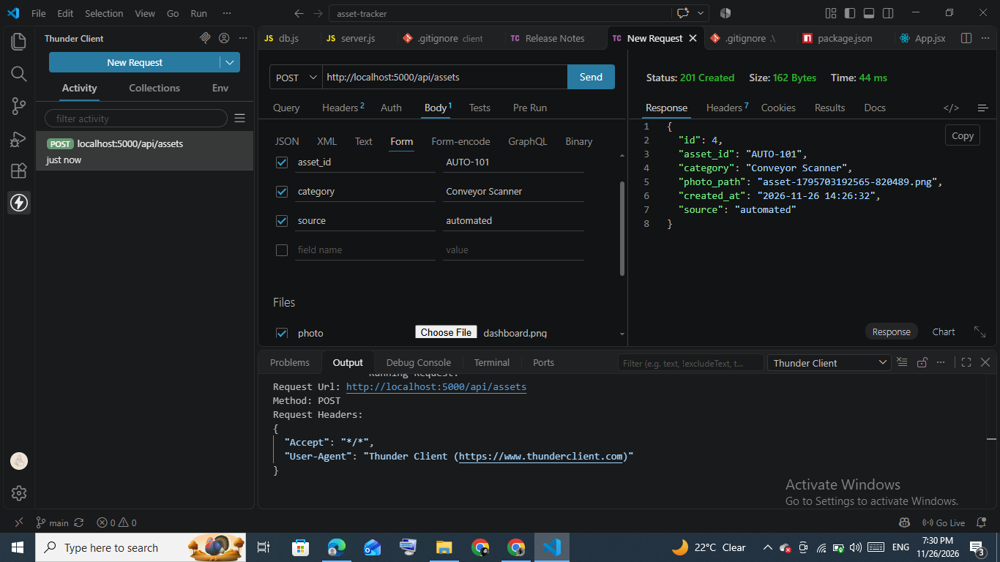
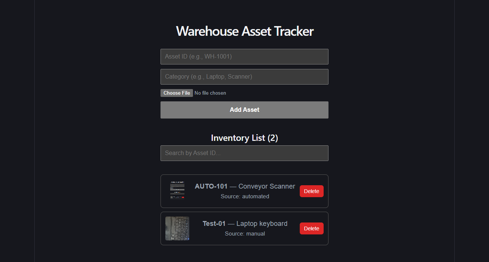
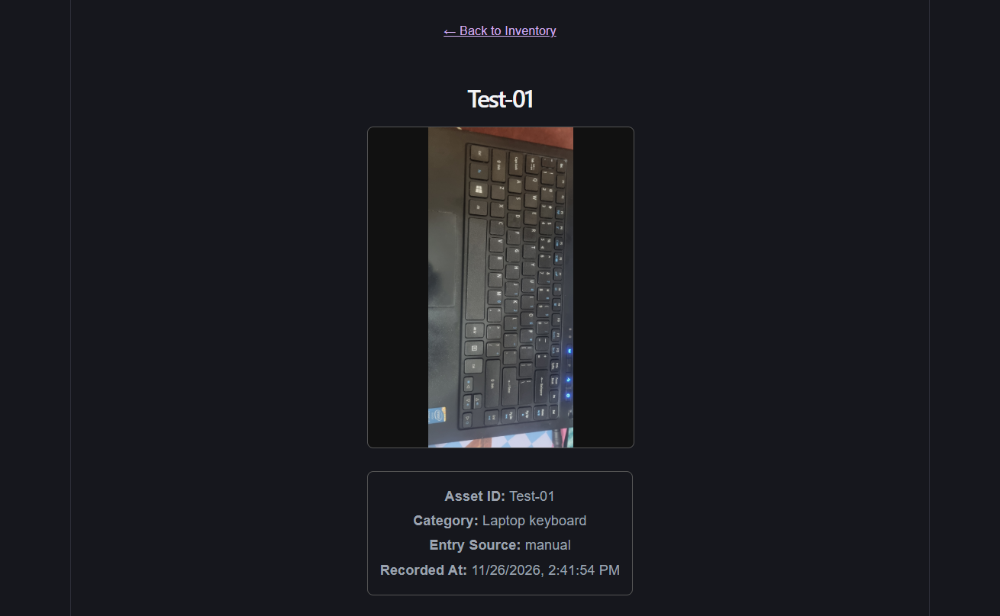

# Warehouse Asset Tracker

A mobile-friendly full-stack web application for logging, searching, and inspecting physical warehouse assets with photographic proof.

> **Prototype Scope:** Designed for local area network (LAN) operation within a warehouse facility with no user authentication required.

## Tech Stack
- **Frontend:** React, Vite, React Router
- **Backend:** Node.js, Express, Multer (multipart file uploads)
- **Database:** SQLite (`better-sqlite3`)

## Setup & Running Locally

### 1. Start the Backend Server
```bash
cd server
npm install
npm start
```
The API server starts on `http://0.0.0` (accessible locally at `http://0.0.0:5000`).

### 2. Start the Frontend Client
```bash
cd client
npm install
npm run dev -- --host
```
Open `http://localhost:5173` on your computer, or open `http://<YOUR-LAN-IP>:5173` on a phone connected to the same Wi-Fi network. *(Optionally set `VITE_API_URL` in `client/.env` to override the default port-5000 host.)*

## API Endpoints

| Method | Endpoint | Description |
| :--- | :--- | :--- |
| `GET` | `/api/assets` | Retrieve all assets, or filter with `?search=<asset_id>` |
| `GET` | `/api/assets/:assetId` | Retrieve full details for a single asset by its `asset_id` |
| `POST` | `/api/assets` | Create a new asset (`multipart/form-data`: `asset_id`, `category`, `photo`, optional `source`) |
| `DELETE` | `/api/assets/:id` | Delete an asset record and remove its stored photo from disk |

## How Automation Plugs In
While warehouse staff log items through the web UI (which defaults to `source=manual`), the `POST /api/assets` endpoint also accepts `source=automated`. Automated barcode scanners, conveyor-belt cameras, or IoT vision scripts can post `multipart/form-data` payloads directly to `/api/assets` with `source=automated` so automated captures are stored alongside manual entries and clearly distinguishable in the inventory audit trail.

## Screenshots

### Dashboard & Inventory List


### Photo Preview & Validation


### Validation & Error States



### Automation API Integration (`source=automated`)




### Asset Detail View (Local Time)


